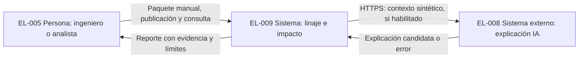
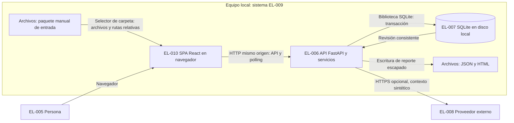
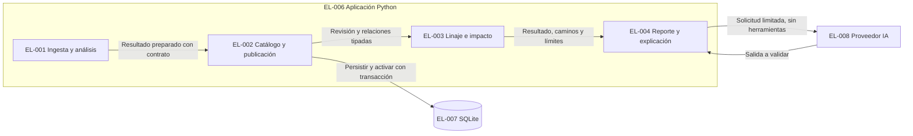

# Vistas de arquitectura — Linaje e impacto

Responsable: Óscar Hernández Barrón  
Fecha-revisada: 2026-11-17  
Revisión: 1.2, TO-BE, propuesta para revisión

Mantengo los bloques Mermaid de este archivo como fuente editable única de las vistas. No se declara renderizado ni aprobación visual. Revisar ante cambios del [SAD](../docs/sad.md), [contratos](../docs/diseno-tecnico.md) o ADR. Las cajas indican tipo y las flechas indican interacción, no orden de ejecución de los DAGs. EL-001 a EL-004 se definen una sola vez en el SAD; son componentes de EL-006. No se requiere vista de código antes de implementar.

## Índice

| Vista | Pregunta | Trazabilidad |
|---|---|---|
| VIEW-001 / contexto | ¿Quién usa el sistema y qué servicios lo rodean? | FR-001, FR-005; ADR-0004; VAL-001, VAL-005 |
| VIEW-002 / contenedores y despliegue local | ¿Qué corre y dónde conserva resultados? | FR-003; ADR-0002, ADR-0003; VAL-003 |
| VIEW-003 / componentes | ¿Cómo se separan las responsabilidades? | FR-001 a FR-005; ADR-0001; VAL-001 a VAL-005 |
| VIEW-004 / secuencia | ¿Cómo se evita una publicación parcial? | NFR-002, QS-002; ADR-0003; VAL-003 |

<a id="EL-005"></a>
## EL-005 — Persona usuaria

Tipo: persona externa. Ingeniero o analista; carga paquetes manuales, publica y consulta. Sin automatización de acceso a repositorios.

<a id="EL-006"></a>
## EL-006 — Aplicación local de linaje

Tipo: contenedor backend Python FastAPI, dentro de EL-009. Routers/API y ejecutor local coordinan los servicios; análisis CPU en proceso hijo controlado. Aloja componentes EL-001, EL-002, EL-003 y EL-004 del SAD. Analiza texto; no ejecuta DAGs.

<a id="EL-007"></a>
## EL-007 — Catálogo SQLite

Tipo: contenedor almacén, dentro de EL-009. Revisiones, aportes, evidencia e invalidaciones; archivo local y acceso por biblioteca SQLite.

<a id="EL-008"></a>
## EL-008 — Servicio de explicación

Tipo: sistema externo OpenAI Responses API. Entrada sintética limitada, HTTPS y credencial fuera de archivos. Integración opcional, sin consumo habilitado por este diseño.

<a id="EL-009"></a>
## EL-009 — Sistema de linaje e impacto

Tipo: sistema de interés. Analiza y conserva conocimiento, consulta y genera reportes. Contiene frontend EL-010, backend EL-006 y catálogo EL-007; salidas son archivos JSON/HTML, no otro servicio.

<a id="VIEW-001"></a>
## VIEW-001 — Contexto C1

TO-BE, revisión 1.2. Frontera de confianza: archivos proporcionados son datos no ejecutables; solo contexto sintético permitido puede salir hacia el proveedor.



<a id="VIEW-002"></a>
## VIEW-002 — Contenedores C2 y ubicación

TO-BE, revisión 1.2. El subgrafo delimita el equipo local como nodo de despliegue; dentro aparecen los contenedores del sistema. No requiere contenedores Docker. Paquetes de entrada y JSON/HTML son archivos, no servicios. API enlazada solo a loopback; no acceso LAN.



<a id="VIEW-003"></a>
## VIEW-003 — Componentes C3 de la aplicación

TO-BE, revisión 1.2. Son módulos del backend, con ejecutor de trabajos y proceso hijo controlado para análisis. La acción web solicita publicación después del análisis, automática solo si completo y sin conflicto; el proveedor no escribe hechos.



<a id="VIEW-004"></a>
## VIEW-004 — Activación consistente

TO-BE, revisión 1.2; secuencia de publicación. El análisis se prepara antes; la explicación sucede después de leer una revisión y fuera de la transacción.

```mermaid
sequenceDiagram
  participant EL_010 as EL-010 Web
  participant EL_006 as EL-006 API y trabajos
  participant EL_001 as EL-001 Análisis
  participant EL_002 as EL-002 Publicación
  participant EL_007 as EL-007 SQLite
  EL_010->>EL_006: Analizar y guardar paquete, con revisiones esperadas
  EL_006->>EL_007: Persistir trabajo y contexto
  EL_006-->>EL_010: job_id para seguimiento
  EL_006->>EL_001: Ejecutar análisis estático en trabajo local
  EL_001-->>EL_006: Resultado completo, parcial o fallido
  EL_006->>EL_007: Guardar resultado y diagnósticos
  alt Resultado completo
    EL_006->>EL_002: Solicitar publicación con operation_id
    EL_002->>EL_007: BEGIN IMMEDIATE y comprobar revisión
    alt Revisión vigente e invariantes válidas
      EL_002->>EL_007: Crear revisión, activar y COMMIT
      EL_002-->>EL_006: Revisión publicada
    else Conflicto o fallo
      EL_002->>EL_007: ROLLBACK si transacción abierta
      EL_002-->>EL_006: Conservado el vigente; motivo de no publicación
    end
  else Parcial o fallido
    EL_006->>EL_007: Guardado sin sustituir catálogo vigente
  end
  EL_010->>EL_006: Consultar estado por job_id
  EL_006-->>EL_010: Resultado, diagnósticos y estado de publicación
```

## Alcance de revisión

La revisión textual comprueba fronteras, identidad y relaciones mediante [VAL-008](../docs/validation.md#VAL-008). El comprobador documental revisa enlaces e IDs, no sintaxis Mermaid. Las cuatro fuentes editables quedan listas para revisar en un visor compatible; renderizado y legibilidad no se declaran comprobados. No se exige una interfaz construida ni una maqueta para revisar estas vistas. Resultados y límites en el [log](../docs/validation-log.md).


<a id="EL-010"></a>
## EL-010 — Interfaz web React

Tipo: contenedor SPA, dentro de EL-009; ejecuta en navegador del equipo local. Pantallas DAGs, Linaje e Impacto; React Query/Axios para API. No accede directamente a SQLite ni tiene credenciales IA. Entrada de archivos mediante selección explícita; [contrato web](../docs/experiencia-web.md).

El navegador ejecuta EL-010; el mismo equipo aloja EL-006/EL-007. El backend sirve el build y /api/v1, conserva jobs y coordina un ejecutor local. En desarrollo Vite actúa como servidor/proxy. VIEW-004 distingue la acción de usuario, la orquestación del backend y la activación: «Analizar y guardar» autoriza ambos pasos, y solo el completo sin conflicto se publica.
