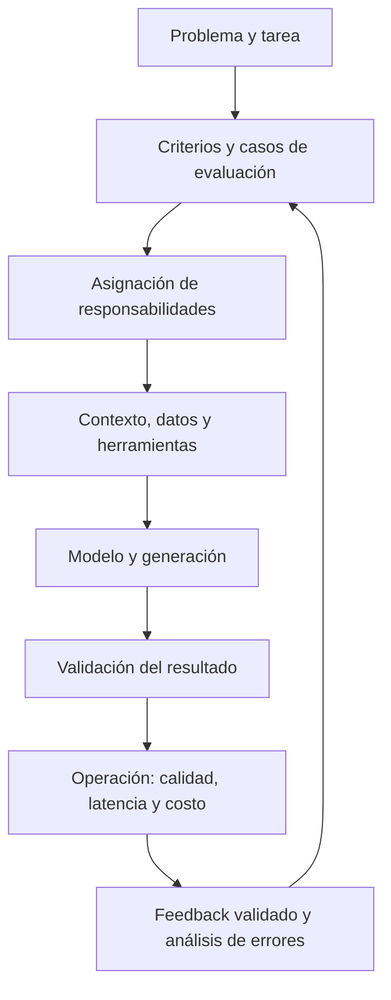
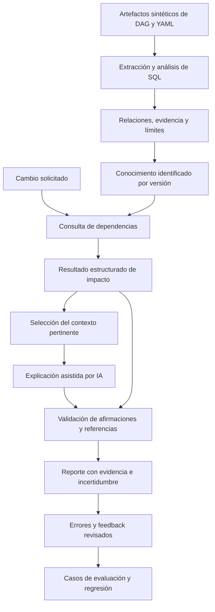

# AI Engineering — Notas de estudio

**Recurso:** *AI Engineering: Building Applications with Foundation Models*.  
**Autora:** Chip Huyen, según la transferencia aportada.  
**Documentación:** 10/11/2026.  
**Alcance:** consolidación de la ruta de estudio de diez días descrita en la [transferencia de conocimiento](../../00-pdi/fuentes/Context_Transfer/ai_engineering_contexto_completo_codex.md).  
**Enfoque:** criterio de arquitectura para diseñar, evaluar y operar aplicaciones con modelos fundacionales; evaluación y contexto aplicados al análisis de linaje.

Estas notas reúnen los conceptos, ejemplos y razonamientos de la ruta en un único documento de consulta. Los diez temas siguen esa ruta, no una numeración de capítulos contrastada con el libro original. No se especifican edición, páginas ni fechas de las sesiones de estudio. La documentación acredita la consolidación del material aportado; no certifica lectura íntegra, evaluación aprobada ni aplicación implementada.

Las explicaciones se basan en la transferencia. Las analogías, ejemplos sintéticos, diagramas, la guía CALIDAD y el caso de arquitectura son elaboraciones didácticas de la ruta, no citas ni estándares atribuidos a la autora. Las aplicaciones al PDI se identifican como propuestas. No se han consultado APIs ni comprobado capacidades de productos específicos para elaborar estas notas.

## Resumen General

**Un modelo de lenguaje es una pieza de la solución.** Su capacidad para interpretar y generar texto necesita una aplicación que obtenga información pertinente, controle permisos, valide resultados y permita medir si el usuario consiguió su objetivo.

La ingeniería de IA conecta seis responsabilidades:

1. **Entender la tarea:** qué problema se resuelve, qué significa una respuesta correcta y qué errores serían relevantes.
2. **Asignar el trabajo:** decidir qué corresponde al modelo, al código, a una consulta de datos o a una herramienta.
3. **Preparar contexto y datos:** dar información suficiente, vigente y autorizada; construir referencias confiables para evaluar.
4. **Medir el sistema completo:** separar exactitud, fidelidad a las fuentes, utilidad, seguridad, latencia y costo.
5. **Elegir la complejidad necesaria:** un flujo fijo puede bastar; RAG, agentes y fine-tuning se justifican por problemas concretos.
6. **Operar y mejorar:** conservar versiones y trazas, investigar errores y convertir feedback validado en nuevas pruebas.

Una respuesta convincente puede ser incorrecta. Una respuesta respaldada por documentos puede seguir siendo incompleta o apoyarse en información desactualizada. Una consulta rápida puede resultar costosa si exige muchas llamadas o correcciones. Por eso la unidad de evaluación debe ser la **tarea resuelta**, con sus restricciones y su costo total.

En el proyecto de linaje, la aplicación propuesta es separar descubrimiento de relaciones, consulta de impacto y explicación asistida por IA. El modelo recibiría resultados con evidencia y límites; su texto no se convertiría automáticamente en una nueva relación verificada.

## Mapa de contenidos

- [1. Ingeniería de aplicaciones con IA](#tema-1)
- [2. Modelos fundacionales y sus límites](#tema-2)
- [3. Metodología de evaluación](#tema-3)
- [4. Evaluación del sistema completo](#tema-4)
- [5. Instrucciones y construcción del contexto](#tema-5)
- [6. RAG, herramientas y agentes](#tema-6)
- [7. Fine-tuning y adaptación](#tema-7)
- [8. Ingeniería de datos para aprendizaje y evaluación](#tema-8)
- [9. Optimización de inferencia](#tema-9)
- [10. Arquitectura, operación y feedback](#tema-10)
- [Aplicación práctica y caso de linaje](#aplicacion)
- [Guía de decisiones](#decisiones)
- [Repaso rápido](#repaso)
- [Glosario](#glosario)
- [Evaluación integradora](#evaluacion-integral)
- [Referencias y alcance de verificación](#referencias)



El mapa es una síntesis didáctica. Evaluación, seguridad y trazabilidad atraviesan todas las etapas; no son tareas que se añaden únicamente al final.

<a id="tema-1"></a>
## 1. Ingeniería de aplicaciones con IA

AI Engineering integra modelos preentrenados con software, datos, herramientas y operación para resolver una tarea. La diferencia respecto a una demostración de generación de texto aparece cuando hay que cumplir requisitos de exactitud, permisos, rendimiento y mantenimiento.

| Disciplina | Centro de atención | Relación con una aplicación de IA |
| --- | --- | --- |
| Ingeniería de software | Interfaces, reglas, pruebas, operación y evolución del sistema. | Aporta controles e integración alrededor del modelo. |
| ML Engineering | Datos, entrenamiento, evaluación y despliegue de modelos. | Permite desarrollar y adaptar capacidades predictivas. |
| AI Engineering con modelos fundacionales | Aprovechar capacidades generales para resolver tareas mediante contexto e integración. | Combina componentes probabilísticos con comportamiento controlado. |

Las disciplinas se superponen. Usar un modelo existente no elimina la necesidad de diseñar software ni de entender datos y evaluación.

### Ejemplo: asistente de consulta de ventas

Ante «¿cuánto vendimos ayer?», una aplicación tendría que aclarar qué significa ventas, delimitar la fecha, obtener un esquema permitido, construir o seleccionar una consulta, validarla, ejecutarla y explicar el resultado. El texto final podría sonar correcto aunque la consulta use una fecha equivocada o una tabla no autorizada.

El fallo debe localizarse en su responsabilidad: interpretación, selección de datos, consulta, ejecución o explicación. Cambiar el modelo sin saber dónde ocurrió el error puede aumentar costo sin resolverlo.

**Analogía de la ruta:** un modelo es el motor de un vehículo. Para utilizarlo hacen falta dirección, frenos, controles y mantenimiento. En la aplicación, esos elementos corresponden a contratos, validaciones, permisos y operación.

**Resumen 80/20:** definir la tarea, separar responsabilidades y evaluar el resultado completo. El modelo no debe absorber reglas que el código puede aplicar de forma exacta.

**Repaso:** ¿qué parte del asistente requiere interpretación y cuál debe resolver una regla? ¿Qué fallo podría pasar inadvertido si solo se evalúa la redacción? Estas preguntas preparan la distinción entre modelo y sistema de los temas 2 a 4.

<a id="tema-2"></a>
## 2. Modelos fundacionales y sus límites

Un modelo fundacional se preentrena con grandes cantidades de datos y puede reutilizarse para distintas tareas. El post-training adapta su comportamiento, por ejemplo para seguir instrucciones. Durante el uso normal, los ejemplos del prompt condicionan la respuesta sin actualizar sus parámetros.

### De texto a generación

La tokenización convierte texto en unidades que procesa el modelo. Un token no equivale necesariamente a una palabra. En muchos modelos de lenguaje, la generación es autoregresiva: cada nuevo token depende del contexto y de los tokens ya generados.

La ventana de contexto limita la cantidad de información que puede considerarse en una interacción. Que una entrada quepa en ella no demuestra que toda su información se use correctamente. Seleccionar contenido relevante sigue siendo una tarea de diseño.

Los embeddings representan información mediante vectores. Sirven para comparar similitud, pero una cercanía semántica no prueba que dos afirmaciones sean verdaderas ni que dos columnas sean el mismo objeto.

En atención, las proyecciones Q, K y V permiten relacionar posiciones y combinar información: conceptualmente, Q participa en qué se busca, K en qué se compara y V en qué se agrega. Es una explicación del mecanismo, no una memoria de hechos verificados.

### Límites que afectan al diseño

| Límite | Consecuencia | Respuesta de ingeniería |
| --- | --- | --- |
| Conocimiento no necesariamente actualizado | Respuesta plausible con datos antiguos. | Consultar fuentes o herramientas vigentes. |
| Afirmaciones sin respaldo | El texto añade hechos inexistentes. | Pedir evidencia y comprobar correspondencia. |
| Variabilidad | Una misma tarea puede producir salidas distintas. | Evaluar estabilidad y casos representativos. |
| Contexto incompleto | Se omite una condición o excepción. | Preparar contexto y declarar información faltante. |
| Costo y latencia de procesamiento | Una respuesta útil puede ser inviable a escala. | Medir entrada, salida y tarea completa. |

El tamaño del modelo, los datos y el cómputo influyen en sus capacidades, pero un modelo mayor no es automáticamente la mejor opción para una tarea. La selección requiere medir las alternativas con los requisitos propios.

**Resumen 80/20:** el conocimiento aprendido, el contexto recibido y los datos consultados son cosas diferentes. Para hechos actuales, obtener evidencia; para cálculos y reglas exactas, asignar una responsabilidad verificable.

**Repaso:** ¿por qué una respuesta fluida no demuestra exactitud? ¿Qué cambia entre añadir ejemplos al contexto y entrenar el modelo? La evaluación del tema 3 convierte esos límites en criterios observables.

<a id="tema-3"></a>
## 3. Metodología de evaluación

Evaluar empieza por definir qué cuenta como éxito. Una respuesta abierta puede tener varias redacciones válidas; compararla literalmente con una frase de referencia suele medir algo distinto de su utilidad o exactitud.

### Dimensiones que conviene separar

| Dimensión | Pregunta de evaluación | Ejemplo de fallo en linaje |
| --- | --- | --- |
| Correctness: exactitud | ¿La conclusión coincide con la referencia válida? | Atribuir dependencia a una columna que no participa. |
| Relevance: pertinencia | ¿Responde a lo solicitado? | Explicar toda la plataforma sin analizar el cambio. |
| Completeness: completitud | ¿Cubre lo necesario dentro del alcance definido? | Omitir un consumidor conocido del caso. |
| Faithfulness: fidelidad | ¿Las afirmaciones están respaldadas por la evidencia recibida? | Añadir un DAG que no figura en los resultados. |
| Seguridad y autorización | ¿Respeta datos, acciones y límites permitidos? | Exponer evidencia fuera del permiso del usuario. |
| Formato | ¿Cumple el contrato de salida? | Omitir el identificador de evidencia requerido. |
| Task success: éxito de tarea | ¿El resultado permite completar el objetivo? | Reporte válido pero insuficiente para decidir qué revisar. |

**Exactitud y fidelidad no son equivalentes.** Una respuesta puede reproducir fielmente un documento desactualizado y resultar incorrecta para la situación actual. También puede acertar por casualidad sin que las fuentes proporcionadas respalden su conclusión. Se deben evaluar ambas.

### Métodos y límites

- **Coincidencia exacta:** adecuada para etiquetas o salidas únicas normalizables; demasiado rígida para explicaciones abiertas.
- **Perplejidad:** describe desempeño de modelado de lenguaje; no demuestra éxito de una aplicación.
- **Similitud semántica:** ayuda a comparar significados; puede considerar parecidas dos respuestas con una diferencia factual crítica.
- **Corrección funcional:** comprueba comportamiento y resultados. En generación de consultas importa el resultado obtenido, además de la validez de la consulta.
- **Modelo como evaluador:** aplica una rúbrica a respuestas. Necesita calibración contra ejemplos revisados y control de sesgos; otra respuesta de IA no es una certificación independiente.
- **Evaluación humana:** útil para ambigüedad, claridad y preferencias. Requiere criterios compartidos para que las valoraciones sean comparables.

La referencia, o **ground truth**, puede ser un resultado conocido, un conjunto de relaciones, varias respuestas aceptables o una rúbrica. Debe definirse antes de observar lo que devuelve el sistema.

### Ejemplo: pregunta a consulta de datos

Comprobar solo que una consulta se ejecuta deja fuera errores de significado. Una consulta puede ejecutarse y sumar una categoría equivocada. Una evaluación completa revisaría autorización, validez, resultado esperado y fidelidad del texto final. Esta es una guía conceptual, no código ejecutado ni una receta de un motor específico.

**Resumen 80/20:** medir lo que importa por separado; una buena redacción no compensa una relación incorrecta. Elegir un método compatible con el tipo de resultado.

**Repaso:** ¿cómo distinguir una explicación fiel de una explicación correcta? ¿Qué referencia permitiría evaluar dependencias sin exigir una redacción concreta? El tema 4 usa estas mediciones para comparar sistemas.

<a id="tema-4"></a>
## 4. Evaluación del sistema completo

La metodología define cómo medir; la evaluación del sistema organiza cuándo y para qué usar esas mediciones. Tiene que permitir seleccionar una solución, detectar regresiones y conocer su comportamiento durante la operación.

### Secuencia de trabajo

1. Definir tarea, valor esperado y restricciones.
2. Preparar casos representativos y referencias confiables.
3. Establecer métricas y criterios antes de ejecutar.
4. Medir una alternativa de referencia o baseline.
5. Comparar cambios en modelo, contexto, recuperación, herramientas o flujo.
6. Investigar errores por componente y segmento.
7. Repetir casos de regresión antes de adoptar un cambio.
8. Observar el uso y convertir errores confirmados en nuevas pruebas.

| Nivel | Qué permite comprobar | Qué no demuestra por sí solo |
| --- | --- | --- |
| Modelo | Calidad de la generación en una tarea delimitada. | Que reciba datos correctos en la aplicación. |
| Componente | Recuperación, parser, herramienta o validación. | Que la combinación cumpla el objetivo final. |
| Extremo a extremo | Resultado que obtiene el usuario con todo el flujo. | La causa del error sin trazas y pruebas parciales. |

### Segmentar para no ocultar errores

Separar consultas sencillas, condiciones, ambigüedad, referencias ausentes y casos difíciles evita que los casos abundantes oculten fallos críticos. El ejemplo de la transferencia de 95 % global frente a 65 % en un segmento es ilustrativo, no una medición del proyecto.

Una comparación por pares presenta dos respuestas para la misma tarea y aplica criterios comunes. Un resultado agregado debe acompañarse de los segmentos donde una opción mejora o empeora. Los benchmarks generales pueden orientar una primera selección, pero no reemplazan los casos del dominio ni descartan contaminación de datos.

La selección dinámica de modelos, o routing, también debe evaluarse. Un modelo económico para tareas sencillas puede reducir costo, pero si el selector envía casos difíciles al modelo equivocado, el sistema pierde calidad.

**Resumen 80/20:** comparar con una base, controlar versiones y mirar los errores por segmento. Cada cambio en contexto, recuperación o generación puede introducir regresiones.

**Repaso:** ¿qué comprobar si mejora el promedio pero empeoran referencias incompletas? ¿Cómo aislar si el fallo viene de recuperar información o de explicarla? El tema 8 profundiza en los datos que permiten esas comparaciones.

<a id="tema-5"></a>
## 5. Instrucciones y construcción del contexto

El prompt comunica objetivo, restricciones y forma de respuesta. La construcción del contexto selecciona también documentos, ejemplos, historial, resultados de herramientas y metadatos. Una instrucción clara no puede recuperar información que nunca se proporcionó ni sustituye un control de autorización.

| Técnica | Qué aporta | Límite |
| --- | --- | --- |
| Zero-shot | Explica la tarea sin ejemplos. | Puede dejar ambiguo qué salida es aceptable. |
| Few-shot | Muestra ejemplos de entrada y salida. | Ejemplos sesgados o irrelevantes orientan mal. |
| In-context learning | Condiciona mediante ejemplos durante la interacción. | No actualiza parámetros ni garantiza aprendizaje persistente. |
| Salida estructurada | Facilita integrar y validar resultados. | Un JSON válido puede contener datos incorrectos. |

### Esqueleto de una instrucción

```text
Objetivo: qué debe resolver la aplicación.
Límites: qué puede afirmar o hacer y qué debe declarar como desconocido.
Contexto: información necesaria, identificada por fuente y versión.
Ejemplos: solo los que aclaren el comportamiento esperado.
Solicitud: pregunta concreta del usuario.
Salida: campos necesarios y significado de cada uno.
```

Es una plantilla didáctica, no sintaxis de una API. En el análisis de impacto, un contexto útil incluiría cambio solicitado, relaciones encontradas, caminos de evidencia, versión y referencias no resueltas. Pedir una explicación sin esos elementos favorece que el modelo rellene huecos.

### Responsabilidades y errores frecuentes

Un prompt que mezcla cálculos, permisos, acceso a datos y redacción es difícil de mantener. La conexión con *A Philosophy of Software Design* es separar responsabilidades y hacer explícitos los contratos. No implica dividir todo en servicios.

En el ejemplo sintético de reclamaciones de la ruta, el modelo puede extraer atributos del texto; un servicio de reglas realiza el cálculo exacto; la aplicación valida el resultado antes de explicarlo. La asignación de responsabilidades es una propuesta didáctica, no una aplicación implementada ni una regla financiera real.

La inyección de instrucciones ocurre cuando contenido externo intenta dirigir el comportamiento. Separar instrucciones y datos en el prompt ayuda a comunicar intención, pero los permisos, la validación de argumentos y los límites de herramientas deben aplicarse fuera del modelo. Un documento no debe poder autorizar una operación.

Conviene versionar instrucciones y casos de regresión, registrar qué versión produjo cada respuesta y medir también el costo del contexto. Añadir más texto puede aumentar latencia y dificultar distinguir la información relevante.

**Resumen 80/20:** pedir una tarea clara, proporcionar evidencia pertinente y validar lo recibido. Formato correcto, contenido correcto y acción autorizada son comprobaciones distintas.

**Repaso:** ¿qué dato necesita la IA antes de explicar una dependencia? ¿Qué regla debe salir del prompt y ejecutarse en código? El tema 6 trata las formas de obtener información y realizar acciones.

<a id="tema-6"></a>
## 6. RAG, herramientas y agentes

Estos conceptos resuelven problemas distintos y no obligan a utilizarse juntos.

| Concepto | Función | Ejemplo sintético |
| --- | --- | --- |
| RAG | Recuperar información y usarla para generar una respuesta. | Consultar una política y explicar sus condiciones. |
| Herramienta | Ejecutar una operación mediante un servicio autorizado. | Consultar días disponibles de vacaciones. |
| Workflow | Ejecutar una secuencia definida de pasos. | Validar datos y preparar una solicitud. |
| Agente | Elegir dinámicamente pasos y acciones para alcanzar un objetivo. | Investigar alternativas y consultar varias fuentes según lo encontrado. |

### Recuperación y generación

Un flujo de RAG puede interpretar la pregunta, recuperar candidatos, reordenarlos, construir contexto y generar la respuesta con referencias. No requiere necesariamente una base vectorial: la recuperación puede provenir de documentos, un buscador, una consulta estructurada o un grafo.

| Estrategia | Ventaja | Riesgo o límite |
| --- | --- | --- |
| Búsqueda léxica | Identificadores y coincidencias exactas. | Puede perder paráfrasis o vocabulario diferente. |
| Búsqueda semántica | Encuentra cercanía de significado. | Similitud no equivale a identidad ni exactitud. |
| Búsqueda híbrida | Combina señales complementarias. | Añade configuración y evaluación del orden. |
| Reranking | Reordena candidatos para priorizar relevancia. | No recupera un documento que nunca llegó a los candidatos. |

El **chunking** divide documentos en fragmentos. Si separa una regla de su excepción, puede producir una respuesta incompleta aunque los fragmentos sean relevantes. La reescritura de consultas usa contexto conversacional para aclarar una pregunta, pero debe conservar su intención.

Evaluar recuperación y generación por separado ayuda a diagnosticar: si la evidencia necesaria no llegó al contexto, cambiar únicamente el generador puede no corregir el problema. La evaluación debe incluir vigencia y permisos, además de relevancia.

### Acciones, memoria y límites

Un agente sigue un ciclo de objetivo, selección de acción, ejecución de herramienta y observación. El siguiente paso depende de lo encontrado. La aplicación debe definir cuándo terminar, cuántas iteraciones permitir y qué hacer ante errores.

La memoria de trabajo guarda información de la tarea; el historial conserva mensajes; la memoria persistente mantiene información entre sesiones. Cada una necesita políticas de relevancia, vigencia y acceso. Guardar todo no garantiza mejor comportamiento.

Las herramientas validan argumentos, permisos y reglas. Las acciones sensibles pueden requerir aprobación según el contexto. Las trazas deben permitir reconstruir llamadas, resultados y fallos, con límites de tiempo y costo. Más autonomía amplía tanto posibilidades como superficie de error.

**Resumen 80/20:** RAG aporta evidencia, las herramientas ejecutan operaciones y los agentes deciden pasos. Empezar con la menor autonomía necesaria para resolver la tarea y evaluarla.

**Repaso:** ¿consultar linaje conocido requiere que un agente decida libremente cada paso? ¿Qué problema resolvería recuperar documentos adicionales? El tema 7 distingue aportar información de modificar el modelo.

<a id="tema-7"></a>
## 7. Fine-tuning y adaptación

Fine-tuning continúa el entrenamiento de un modelo existente para adaptar su comportamiento. A diferencia de añadir contexto, modifica parámetros. Puede servir para patrones estables de una tarea, pero no es una solución automática para información desactualizada, recuperación deficiente o reglas exactas.

### Técnicas y ejes distintos

| Concepto | Qué describe | Consideración |
| --- | --- | --- |
| Full fine-tuning | Actualización de todos o casi todos los parámetros. | Mayor demanda de memoria y cómputo. |
| PEFT | Familia de adaptaciones eficientes en parámetros. | Reduce parámetros entrenables, no elimina evaluación. |
| LoRA | Actualización de bajo rango sobre matrices base congeladas en su formulación habitual. | Rango y capas adaptadas condicionan capacidad y costo. |
| QLoRA | Base cuantizada combinada con adaptación LoRA. | Reduce memoria de entrenamiento; requiere validar calidad. |
| SFT | Aprendizaje supervisado con entradas y salidas deseadas. | Depende de ejemplos correctos y representativos. |
| Optimización de preferencias | Aprende de comparaciones entre respuestas, como en DPO. | La calidad y sesgos de preferencias importan. |
| Distillation | Enseña a un modelo estudiante con señales de otro. | Evaluar qué capacidades conserva y cuáles pierde. |
| Model merging | Combina pesos o adaptaciones. | Puede introducir interferencias entre capacidades. |

SFT describe una forma de supervisión; LoRA describe una forma de adaptar parámetros. Son ejes que pueden combinarse, no alternativas necesariamente excluyentes. Las adaptaciones pequeñas también necesitan compatibilidad, versionado y pruebas junto con su modelo base.

### Intuición matemática de LoRA

En vez de entrenar una actualización completa de una matriz W, se representa una actualización como ΔW = B × A, con un rango menor. Para una matriz de 4096 × 4096 hay 16,777,216 parámetros. Con rango 8, dos matrices de 4096 × 8 y 8 × 4096 suman 65,536 parámetros: aproximadamente 0.39 % de esa matriz original.

Es un ejemplo aritmético local de la transferencia. No representa el porcentaje entrenable ni la memoria total de un modelo completo; la base y otros consumos siguen existiendo.

### Decidir si hace falta

Definir la tarea y una base de comparación; probar primero instrucciones, contexto o código según la causa del problema; revisar datos disponibles; ejecutar un experimento controlado; comparar calidad, costo total y capacidades que deben conservarse.

Mejorar una tarea puede degradar otras: el olvido catastrófico exige evaluar también capacidades previas relevantes. Un buen resultado sobre ejemplos vistos puede ser sobreajuste, no generalización. Entrenar añade mantenimiento del conjunto de datos, versiones y despliegue.

En linaje, la propuesta de la ruta es evaluar primero un parser y su representación estructural para patrones soportados. Un LLM puede aportar hipótesis en casos ambiguos, pero la validación posterior sigue siendo necesaria. No se ha aceptado sustituir el parser ni entrenar un modelo en el PDI.

**Resumen 80/20:** adaptar el modelo solo cuando la necesidad y los datos lo justifiquen. Cambiar comportamiento y aportar conocimiento actualizado son problemas diferentes.

**Repaso:** ¿qué fallo concreto justificaría fine-tuning frente a mejorar el contexto? ¿Cómo comprobar que una mejora especializada no degrada otras tareas? El tema 8 desarrolla la calidad de los datos necesarios.

<a id="tema-8"></a>
## 8. Ingeniería de datos para aprendizaje y evaluación

Un conjunto de datos útil representa la tarea con etiquetas y referencias confiables. Su tamaño no compensa errores, falta de diversidad o concentración en ejemplos fáciles. La ingeniería de datos incluye adquisición, limpieza, selección, anotación, control de calidad, versionado y mantenimiento.

### Separar usos y evitar contaminación

| Partición | Uso | Error que debe evitarse |
| --- | --- | --- |
| Entrenamiento | Aprender o adaptar parámetros. | Incluir información que solo existiría después de la predicción. |
| Validación | Elegir opciones y ajustar el sistema. | Confundir selección con evaluación final independiente. |
| Prueba | Medir comportamiento sin usar sus respuestas para ajustar. | Reutilizarla repetidamente como guía de desarrollo y seguir llamándola independiente. |

Duplicados y variantes casi idénticas pueden cruzar particiones e inflar resultados. La separación debe considerar la procedencia de los ejemplos; cambiar nombres en una consulta no necesariamente crea un caso independiente. En información histórica hay que impedir que el futuro se filtre a la evaluación del pasado.

### Calidad, cobertura y anotación

La guía de anotación debe definir qué se etiqueta y cómo resolver ambigüedades. El acuerdo entre anotadores informa sobre consistencia; medidas como Cohen's Kappa contemplan el acuerdo esperado por azar. El acuerdo no prueba que la etiqueta sea correcta si todos comparten el mismo error.

Los datos sintéticos permiten explorar situaciones controladas sin usar información de clientes. Deben validarse: un ejemplo generado por IA no se convierte por eso en una referencia correcta. El aumento de datos crea variaciones, cuidando que preserven la etiqueta. Los casos difíciles ayudan a descubrir límites; active learning prioriza ejemplos informativos para revisión cuando resulte útil.

Un cambio de distribución ocurre cuando los datos de uso difieren de los de desarrollo. Conviene registrar fuentes, transformaciones, versiones, cobertura y límites para saber dónde se sostienen las conclusiones.

### Ejemplo didáctico para linaje

La transferencia propone explorar proyecciones, alias, condiciones, agregaciones, subconsultas, CTE, escrituras, vistas y SQL dinámico. Son familias candidatas para una evaluación, no soporte demostrado ni una ampliación automática del alcance. El PDI mantiene Spark SQL como referencia; estudiar varios dialectos en general no compromete soportarlos.

Para cada caso se necesitarían archivos, esquemas cuando correspondan, relaciones esperadas de tablas y columnas, pasos STG, condiciones y evidencia. Una columna utilizada en un filtro puede afectar las filas del resultado aunque no aporte directamente su valor a una columna de salida.

**Complemento didáctico para interpretar las métricas de la ruta:**

```text
Precisión = relaciones correctas detectadas / todas las relaciones detectadas
Recall o exhaustividad = relaciones correctas detectadas / relaciones esperadas
```

Si se esperaban 10 relaciones y se detectan 9, de las cuales 8 son correctas, la precisión es 8/9 y el recall 8/10. Es un ejemplo hipotético, no un resultado. Si un denominador es cero, documentar el tratamiento; no asignar automáticamente un éxito. Separar tablas, columnas y condiciones para no ocultar errores de una clase con aciertos de otra.

**Resumen 80/20:** fijar referencias antes de medir, separar datos de selección y prueba, cubrir casos difíciles y conservar procedencia. Sin referencias confiables, una métrica precisa puede medir algo equivocado.

**Repaso:** ¿cómo evitar que variantes del mismo DAG contaminen particiones? ¿Quién o qué demuestra que las relaciones de referencia son correctas? Esto conecta los datos con la metodología de los temas 3 y 4.

<a id="tema-9"></a>
## 9. Optimización de inferencia

Optimizar exige conservar una calidad aceptable mientras se reduce tiempo, costo o consumo de recursos. La latencia del usuario incluye recuperación, herramientas, generación, validación, reintentos y pasos secuenciales; no solo el tiempo del modelo.

### Qué medir

| Métrica | Significado | Precaución |
| --- | --- | --- |
| Latencia total | Tiempo hasta obtener el resultado de la solicitud. | Un promedio oculta respuestas muy lentas. |
| p50, p95, p99 | Percentiles de la distribución de tiempos. | Necesitan muestra y condiciones descritas. |
| TTFT | Tiempo hasta el primer token. | Empezar rápido no significa terminar rápido. |
| Tokens por segundo | Velocidad de generación. | No equivale a tareas resueltas por segundo. |
| Throughput | Trabajo atendido por unidad de tiempo. | Puede mejorar a costa de espera individual. |
| Concurrencia | Solicitudes atendidas simultáneamente. | Está relacionada con memoria, colas y carga. |
| Costo por tarea exitosa | Costo total respecto a resultados aceptables. | Incluir errores y reintentos, no solo llamadas exitosas. |

### Fases y memoria

El prefill procesa el contexto de entrada. El decode genera tokens sucesivamente. La KV Cache reutiliza representaciones de atención para evitar recalcular trabajo previo durante la generación, pero consume memoria.

| Técnica estudiada | Beneficio buscado | Trade-off o condición |
| --- | --- | --- |
| Reducir contexto irrelevante | Menos procesamiento y ruido. | No eliminar evidencia necesaria. |
| Caché de prefijos | Reutilizar procesamiento repetido. | Depende de la integración y de coincidencias válidas. |
| Caché de respuestas | Evitar volver a resolver una consulta equivalente. | Respetar vigencia, versiones y permisos. |
| Batching | Aprovechar recursos agrupando trabajo. | Puede añadir espera a una solicitud. |
| Continuous batching | Incorporar y retirar solicitudes durante generación. | Gestión de carga y memoria más compleja. |
| PagedAttention | Gestionar KV Cache en bloques. | Técnica conceptual; no implica soporte de un proveedor elegido. |
| Cuantización | Reducir bits y memoria. | Calidad y velocidad dependen de tarea y hardware. |
| Speculative decoding | Proponer tokens con un mecanismo auxiliar y verificarlos con el modelo objetivo. | El beneficio depende del costo y aceptación de propuestas. |
| Distillation y routing | Usar capacidad menor cuando sea suficiente. | Evaluar pérdidas y errores de selección. |
| Paralelismo tensor, pipeline o datos | Distribuir partes del cálculo o carga. | Añade comunicación y depende de infraestructura. |

Son conceptos de estudio, no recomendaciones de configuración actual de un producto. En una API gestionada, varias optimizaciones internas no están bajo control de la aplicación. Antes de diseñar infraestructura propia, conviene medir qué trabajo innecesario puede evitarse.

### Dos cálculos ilustrativos

Para 7,000 millones de parámetros, solo los pesos ocuparían aproximadamente 28 GB en FP32, 14 GB en FP16, 7 GB en INT8 y 3.5 GB en INT4. Se usan GB decimales y un cálculo ideal de bits por parámetro; no incluye KV Cache, activaciones, metadatos ni otros consumos. No permite dimensionar por sí solo una máquina de inferencia.

```text
Costo de tokens = (tokens de entrada × precio de entrada por millón
                + tokens de salida × precio de salida por millón) / 1,000,000
```

Con precios hipotéticos de USD 1 por millón de entrada y USD 4 por millón de salida, 3,000 tokens de entrada y 500 de salida costarían USD 0.005. Cien mil solicitudes iguales sumarían USD 500. Son números didácticos de la transferencia, no tarifas actuales ni una cotización; faltan herramientas, almacenamiento, infraestructura y reintentos.

**Resumen 80/20:** medir primero el cuello de botella y comparar calidad, costo y tiempo después del cambio. En flujos con varias llamadas, evitar trabajo redundante y paralelizar solo operaciones independientes.

**Repaso:** ¿qué implica un TTFT bajo con alta latencia total? ¿Cómo invalidar una explicación guardada cuando cambia el linaje? El tema 10 conecta estas métricas con operación y versiones.

<a id="tema-10"></a>
## 10. Arquitectura, operación y feedback

La diferencia entre una demostración y una solución operable está en cómo se controla su comportamiento cuando cambian los datos, falla una dependencia o aparecen tareas distintas. Una arquitectura necesita observabilidad, evaluación, seguridad y capacidad de mejora.

### Capas de referencia de la ruta

| Responsabilidad | Contenido |
| --- | --- |
| Experiencia | Interfaz, API o integración donde el usuario recibe el resultado. |
| Aplicación y coordinación | Flujo, estado, pasos y límites de ejecución. |
| Contexto | Instrucciones, evidencia recuperada, historial y metadatos. |
| Modelos | Generación, embeddings y otras capacidades especializadas. |
| Datos e integración | Repositorios, servicios, herramientas y fuentes. |
| Controles transversales | Autorización, validación, evaluación, trazas y costos. |

Es una organización didáctica de responsabilidades, no un estándar del libro ni una obligación de desplegar seis servicios.

### Observabilidad y evaluación

Los logs registran eventos; las métricas permiten observar tendencias y distribuciones; las trazas conectan los pasos de una solicitud. Registrar versión de modelo, prompt, datos recuperados y herramientas ayuda a explicar qué cambió entre dos resultados. Las trazas también pueden contener información sensible: acceso, conservación y contenido deben diseñarse.

La evaluación offline usa casos controlados; un entorno de prueba de integración comprueba el sistema combinado; la evaluación online observa el uso real. Una buena métrica offline no elimina la necesidad de comprobar comportamiento con entradas nuevas.

### Convertir feedback en aprendizaje verificable

El feedback explícito incluye comentarios o valoraciones. El implícito incluye reformular una pregunta, abandonar, aceptar o editar una respuesta. Son señales para investigar: una aceptación no prueba exactitud y una valoración negativa no identifica automáticamente la causa.

Un ciclo útil sería localizar la solicitud, reconstruir sus versiones y evidencia, clasificar el error, validar la corrección esperada, añadir un caso de regresión y comprobar el cambio. El feedback no debe incorporarse sin revisión a una referencia de evaluación o a datos de entrenamiento.

### Seguridad y madurez

Los permisos se aplican en servicios y herramientas. El contenido recuperado se trata como datos, las salidas se validan antes de acciones y las operaciones sensibles se sujetan a los controles apropiados. Una instrucción al modelo no sustituye esos mecanismos.

La ruta distingue tres niveles didácticos: prototipo que demuestra posibilidad; solución controlada con pruebas, trazabilidad y límites; mejora continua con feedback y evaluación sostenida. Son una guía de reflexión, no una clasificación certificada.

**Resumen 80/20:** observar el sistema completo, preservar versiones y validar feedback antes de convertirlo en conocimiento. La mejora debe demostrarse mediante comparación y regresión.

**Repaso:** ¿qué información permite reproducir un error de explicación? ¿Qué evidencia falta para convertir un comentario negativo en un caso de prueba? El caso siguiente reúne los diez temas.

<a id="aplicacion"></a>
## Aplicación práctica: analizador de linaje e impacto

**Estado: propuesta didáctica para el PDI; sin decisión aceptada ni implementación acreditada.** El entorno GCP, almacenamiento Parquet, metadatos, procesamiento y DAGs de la transferencia describe el contexto de referencia. No obliga a desplegar servicios ni selecciona tecnología de persistencia.

### Separar descubrimiento, consulta y explicación



El parser y una representación estructural como un AST pueden ayudar a interpretar consultas soportadas, pero disponer de un AST no demuestra resolución completa de columnas. También importan esquemas, ámbito, parámetros y convenciones. La elección entre reutilizar, adaptar o sustituir el parser sigue requiriendo inspección.

Representar relaciones como un grafo permite razonar sobre caminos de dependencias; no obliga a adoptar una base de datos de grafos. La arquitectura concreta debe comparar alternativas según consultas, actualización y esfuerzo.

### Recorrido sintético

DAG 1 produce total a partir de precio y cantidad. DAG 2 utiliza total. DAG 3 consume la misma tabla, pero solo identificadores y región en la variante propuesta. Ante eliminar precio, la consulta debería distinguir el camino de valor hacia DAG 2 del consumo de tabla de DAG 3. Esa distinción tampoco garantiza que DAG 3 pueda ejecutarse si su productor falla.

Si falta el archivo de DAG 2, la explicación debe conservar esa incertidumbre. La IA no puede convertir el nombre del proceso en evidencia de qué columnas utiliza. El reporte necesita indicar qué se analizó y qué versión representa; una lista vacía no acredita ausencia de dependencias fuera de esa cobertura.

### Aplicaciones que conviene evaluar

| ID | Propuesta derivada del estudio | Cómo comprobarla | Trade-off |
| --- | --- | --- | --- |
| AIE-01 | Evaluar relaciones, evidencia y explicación por separado, además de la tarea completa. | Preparar esperados de tablas/columnas/condiciones y una rúbrica de afirmaciones antes de ejecutar. | Más preparación, a cambio de localizar causas y evitar métricas engañosas. |
| AIE-02 | Entregar a la IA únicamente el resultado pertinente con evidencia, versiones y referencias no resueltas. | Revisar que las afirmaciones tengan sustento y que el contexto no omita límites relevantes. | Contexto menor reduce trabajo, pero una selección excesiva puede quitar información necesaria. |
| AIE-03 | Convertir errores confirmados en ejemplos versionados de regresión. | Registrar entrada, esperado, obtenido, causa y repetición tras corregir. | Mantener los casos cuesta trabajo; permite comprobar que una mejora no reintroduzca errores. |

Estas propuestas complementan [APSD-01 a APSD-03](../aplicacion-al-proyecto.md#aplicaciones-software-design): contratos del análisis, mantenimiento por DAG y separación de resultados/explicación. El [registro de aplicación](../aplicacion-al-proyecto.md) enlaza las notas; las decisiones aceptadas se documentarán en [ADR](../../02-arquitectura/decisiones/README.md).

Se conservan diez cambios y cinco comparaciones manuales del PDI. Las pruebas de parser, mantenimiento y explicación no sustituyen esos compromisos. Tampoco se incorpora soporte multidialecto, fine-tuning, agentes ni infraestructura por aparecer en el material de estudio.

<a id="decisiones"></a>
## Guía de decisiones

| Necesidad | Alternativa inicial por evaluar | Señal de que conviene reconsiderar |
| --- | --- | --- |
| Explicar mejor o ajustar formato | Instrucción clara, ejemplos y validación. | El problema real es falta de datos, no redacción. |
| Incorporar documentación vigente | Recuperación de fuentes pertinentes. | Las fuentes no tienen vigencia o permisos comprobables. |
| Consultar datos actuales | Herramienta o consulta autorizada. | La operación excede permisos o no tiene resultado verificable. |
| Aplicar regla o cálculo exacto | Código y pruebas. | Se intenta resolver ambigüedad de lenguaje como si fuera regla fija. |
| Coordinar pasos conocidos | Flujo explícito. | Las rutas varían de forma que el flujo deja de cubrir la tarea. |
| Elegir pasos según hallazgos | Agente limitado y evaluado. | Autonomía añade costo y fallos sin mejorar el resultado. |
| Adaptar comportamiento repetitivo | Considerar fine-tuning tras medir una base. | No hay datos confiables ni ventaja demostrable. |
| Reducir costo y latencia | Medir pasos, quitar trabajo redundante y evaluar caché o routing. | El ahorro degrada calidad o reutiliza evidencia desactualizada. |
| Corregir respuestas equivocadas | Diagnóstico por componente y caso. | Se cambia el modelo sin identificar la causa. |

La regla práctica es elegir la intervención que resuelve la causa observada con una complejidad justificable. Estas alternativas pueden combinarse; no constituyen una escalera obligatoria hacia una arquitectura más sofisticada.

### Lista CALIDAD de la ruta

Mnemotecnia didáctica, no estándar de la autora:

- **C — Contexto:** ¿la respuesta recibe información suficiente y pertinente?
- **A — Arquitectura:** ¿cada responsabilidad tiene un lugar claro?
- **L — Límites:** ¿datos y acciones están acotados y autorizados?
- **I — Integración:** ¿qué sistemas y herramientas intervienen?
- **D — Datos y evaluación:** ¿con qué referencia comprobamos exactitud?
- **A — Administración operativa:** ¿cómo controlamos versiones, costo y latencia?
- **D — Desarrollo continuo:** ¿cómo se convierten errores en mejoras comprobadas?

<a id="repaso"></a>
## Repaso rápido

| Recordatorio | Pregunta práctica |
| --- | --- |
| El modelo es un componente. | ¿Qué resuelve la aplicación alrededor de él? |
| Exactitud no equivale a fidelidad. | ¿Es correcto y está sustentado? |
| Formato no equivale a validez. | ¿Los campos cumplen significado y permisos? |
| Recuperar no garantiza encontrar lo necesario. | ¿Llegó la evidencia correcta al contexto? |
| Más autonomía requiere más control. | ¿Hace falta decidir pasos dinámicamente? |
| Fine-tuning modifica parámetros. | ¿La causa requiere adaptar comportamiento? |
| Más ejemplos no garantizan representatividad. | ¿Qué situaciones faltan y qué datos se repiten? |
| TTFT no equivale a latencia total. | ¿Cuánto tarda el usuario en obtener el resultado útil? |
| Caché exige vigencia y permisos. | ¿Se puede reutilizar esta respuesta en este contexto? |
| Feedback es una señal. | ¿Se validó antes de convertirlo en referencia? |

**Antes de elegir un modelo:** definir tarea, referencia, restricciones y base de comparación.  
**Antes de añadir RAG:** comprobar que falta información recuperable y autorizada.  
**Antes de añadir un agente:** justificar decisiones dinámicas y límites de acción.  
**Antes de entrenar:** verificar datos y demostrar que opciones más simples no resuelven la causa.  
**Antes de optimizar:** localizar el cuello de botella y fijar la calidad que debe conservarse.  
**Antes de declarar éxito:** revisar segmentos, errores, costos y límites de la evidencia.

<a id="glosario"></a>
## Glosario

| Término | Significado de consulta |
| --- | --- |
| Agent | Sistema donde un modelo selecciona pasos o acciones hacia un objetivo. |
| Annotation | Etiquetado con criterios para aprender o evaluar. |
| AST | Representación estructural de una consulta o programa; requiere resolución adicional según la tarea. |
| Baseline | Resultado o alternativa de referencia para comparar mejoras. |
| Batching | Agrupación de trabajo para aprovechar recursos. |
| Chunking | División de documentos en fragmentos recuperables. |
| Context engineering | Selección y organización de instrucciones, evidencia y datos de la tarea. |
| Correctness | Exactitud frente a una referencia o comportamiento esperado. |
| Data leakage | Información que contamina la separación entre desarrollo y evaluación. |
| Dataset | Conjunto de ejemplos; en estas notas también se usa “casos de prueba” según su propósito. |
| Decode | Generación sucesiva de tokens. |
| Distillation | Aprendizaje de un modelo estudiante usando señales de otro. |
| Distribution shift | Diferencia entre la distribución de desarrollo y la de uso. |
| Embedding | Representación vectorial útil para comparar información. |
| Faithfulness | Respaldo de la respuesta en la evidencia proporcionada. |
| Fine-tuning | Entrenamiento adicional que adapta parámetros. |
| Foundation model | Modelo general preentrenado reutilizable. |
| Ground truth | Referencia confiable para evaluar una tarea. |
| Hybrid search | Recuperación que combina señales léxicas y semánticas. |
| Inference | Uso de un modelo entrenado para producir una salida. |
| KV Cache | Representaciones de atención reutilizadas durante la generación. |
| Latency | Tiempo de atención de una solicitud. |
| LoRA | Adaptación mediante actualizaciones de matrices de bajo rango. |
| LLM-as-a-judge | Modelo usado como evaluador con una rúbrica y calibración. |
| Model routing | Selección de modelo según tarea y restricciones. |
| PEFT | Métodos de adaptación eficientes en parámetros. |
| Prefill | Procesamiento inicial del contexto de entrada. |
| Prompt injection | Intento de introducir instrucciones mediante contenido no confiable. |
| QLoRA | Adaptación LoRA con base cuantizada. |
| RAG | Generación apoyada en información recuperada. |
| Recall | Proporción de elementos esperados que fueron encontrados correctamente. |
| Reranking | Reordenamiento de candidatos recuperados. |
| SFT | Ajuste supervisado con ejemplos de entradas y salidas. |
| Speculative decoding | Propuesta auxiliar y verificación de tokens para acelerar generación. |
| Task success | Cumplimiento del objetivo de la tarea. |
| Throughput | Trabajo procesado por unidad de tiempo. |
| TTFT | Tiempo hasta el primer token. |
| Trace | Registro que conecta pasos, llamadas y resultados de una ejecución. |

<a id="evaluacion-integral"></a>
## Evaluación integradora

**Ejercicio de repaso, sin evaluación ejecutada ni puntuación atribuida:** defender el diseño de un analizador de impacto que recibe DAGs y configuraciones, conserva evidencia y explica candidatos ante cambios de columnas.

La defensa debería responder estas preguntas con un ejemplo y una alternativa descartada:

| Pregunta | Qué debe aparecer en una respuesta sólida |
| --- | --- |
| ¿Qué diferencia hay entre integrar un modelo y construir la solución? | Responsabilidades de datos, reglas, permisos, validación y operación. |
| ¿Qué información no debe inventar el modelo? | Relaciones no respaldadas y resultados de ejecución no observados. |
| ¿Cómo evaluar una consulta generada? | Resultado y autorización, además de sintaxis y explicación. |
| ¿Cómo distinguir exactitud, fidelidad y utilidad? | Criterio independiente para cada dimensión. |
| ¿Qué detecta una regresión de prompt? | Casos versionados y comparación antes/después por segmento. |
| ¿Qué búsqueda elegir y cómo dividir documentos? | Identificadores frente a significado; reglas y excepciones juntas. |
| ¿Qué autonomía hace falta? | Diferencia entre flujo fijo y pasos dinámicos, con límites explícitos. |
| ¿Qué controla una herramienta que modifica datos? | Argumentos, permisos y reglas fuera del modelo. |
| ¿Qué justificaría fine-tuning y cómo evaluar LoRA o QLoRA? | Necesidad, datos, memoria, calidad y capacidades que conservar. |
| ¿Cómo evitar sobreajuste, olvido y contaminación? | Separación por procedencia y evaluación de capacidades previas. |
| ¿Cómo elegir ejemplos difíciles o active learning? | Cobertura de errores y valor de revisar cada caso. |
| ¿Qué cambia entre TTFT, tiempo total y throughput? | Experiencia individual frente a capacidad del sistema. |
| ¿Cuándo sirven KV Cache, batching, routing o caché? | Cuello de botella, control disponible, calidad y vigencia. |
| ¿Cómo usar feedback negativo? | Validar la causa y convertirla en una prueba reproducible. |
| ¿Cómo defender la solución más sencilla? | Comparar valor, evidencia, costo y esfuerzo de mantenimiento. |

Las preguntas de cada tema y esta defensa integran el banco de repaso de la transferencia. La rúbrica orienta el estudio; no demuestra que las respuestas se hayan presentado ni aprobado.

<a id="referencias"></a>
## Referencias y alcance de verificación

- **Fuente principal:** [AI Engineering — Contexto consolidado de estudio para Codex](../../00-pdi/fuentes/Context_Transfer/ai_engineering_contexto_completo_codex.md), aportado por el usuario. Contiene la ruta de diez días, analogías, métricas, caso integrador y preguntas. Se conserva sin modificaciones.
- **Recurso identificado en esa fuente:** *AI Engineering: Building Applications with Foundation Models*, Chip Huyen. No se consultó un ejemplar original para verificar citas, páginas, edición o correspondencia exacta de capítulos.
- **Convención aplicada:** [prompt base de documentación](../../00-pdi/auxiliar/prompt-documentar-cursos-y-libros.md), material local auxiliar excluido de Git. Estas notas son autocontenidas y no requieren ese archivo para su lectura.
- **Conexiones del repositorio:** [A Philosophy of Software Design](a-philosophy-of-software-design.md), [arquitectura conceptual](../../02-arquitectura/docs/sad.md) y [plan de evaluación](../../02-arquitectura/docs/validation.md).

La estructura de varios archivos sugerida en la transferencia se consolidó en uno por la convención del repositorio y el prompt solicitado. Las cifras son ejemplos aritméticos, las técnicas se describen conceptualmente y las propuestas de arquitectura no acreditan capacidades del parser ni resultados. Las consultas específicas de bibliotecas, proveedores o versiones deberán contrastarse con documentación vigente al implementarse. No se infieren fechas de finalización del estudio ni cumplimiento de las demás lecturas del PDI.
